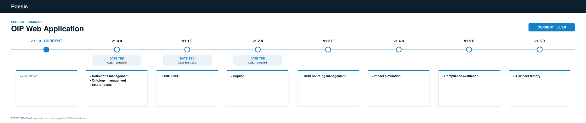

# OIP Web Frontend

[](https://github.com/poesis-cloud/oip-web-frontend/actions/workflows/ci.yaml)
[](https://github.com/poesis-cloud/oip-web-frontend/releases/latest)
[](app/package.json)
[](app/package.json)
[](LICENSE)

Angular 21 LTS frontend for OIP with PrimeNG, Tailwind, signal-based authentication, Docker runtime, and Helm deployment.

## Structure

```
app/            # Angular application (source, tests, Cypress)
def/
  mockups/      # HTML/CSS interactive screen mockups and design references
ops/            # Docker + Helm deployment assets
```

## Local development

```bash
cd app
nvm use 22.21.1
npm ci
npm run start
```

The dev profile uses an Angular proxy so `/api` requests are forwarded to `http://localhost:8080`.

## Container build

```bash
docker build -t oip-web-frontend:local .
cat > /tmp/runtime-config.js <<'EOF'
window.__APP_CONFIG__ = {
  apiBaseUrl: 'http://localhost:8080'
};
EOF

docker run --rm \
  -p 8081:80 \
  -v /tmp/runtime-config.js:/usr/share/nginx/html/runtime-config.js:ro \
  oip-web-frontend:local
```

## Helm deployment

```bash
make dev-check
make dev-up
make run-ui
```

<!-- roadmap:start -->
## Roadmap



<!-- roadmap:end -->
